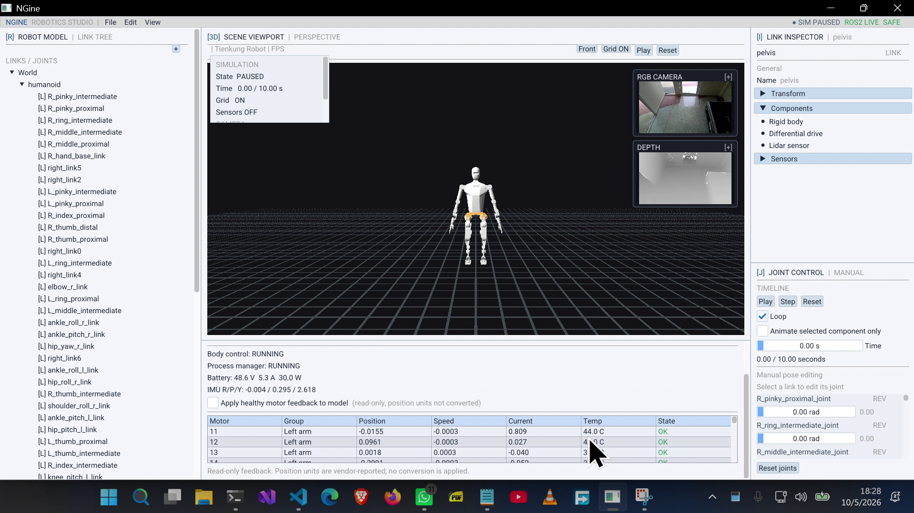
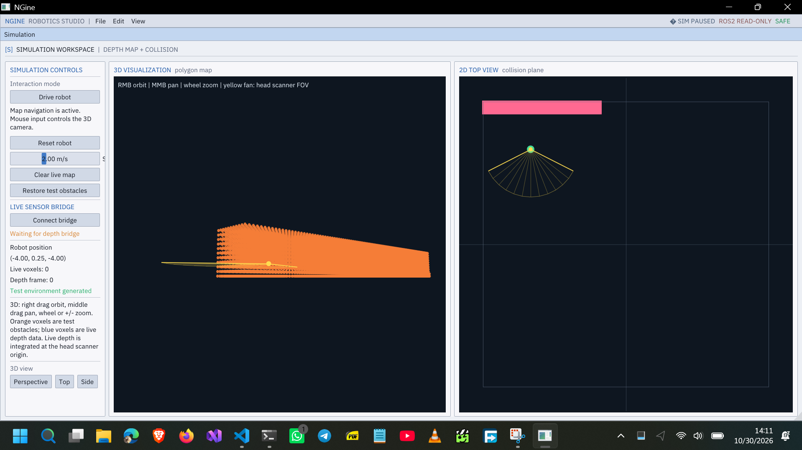
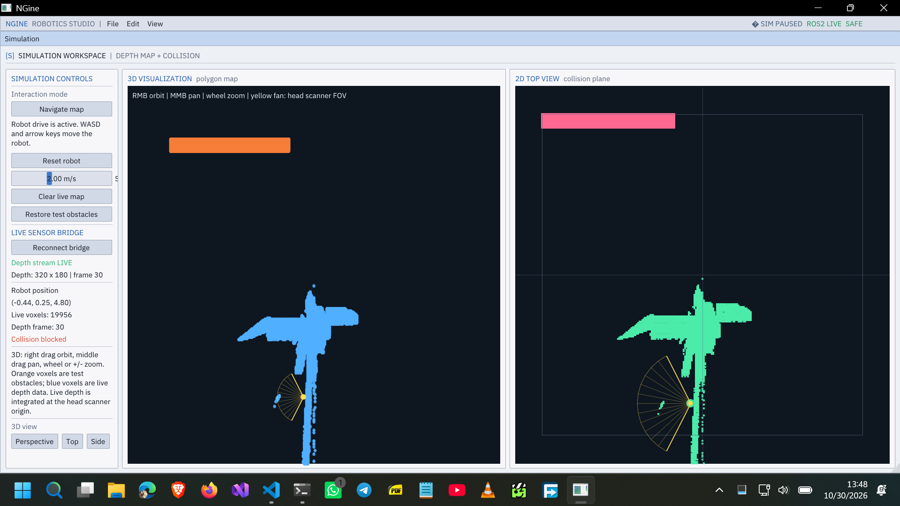
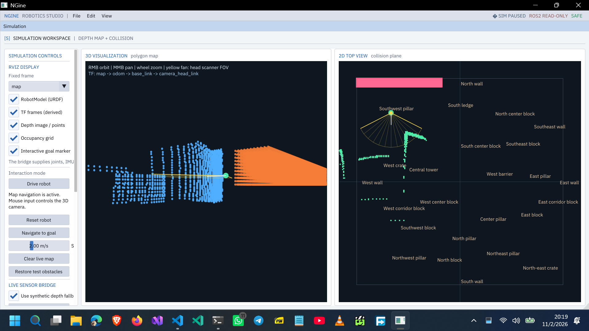
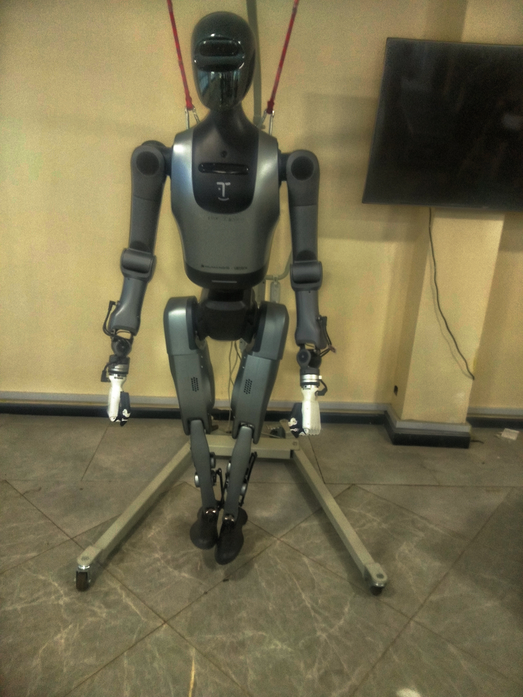

# NGine

NGine is a C++20/OpenGL robotics visualization application with two separate workspaces:

- **Animation workspace** — inspect the robot model, edit joints, preview animations, and review telemetry.
- **Simulation workspace** — visualize depth data, inspect a persistent map, and drive a local robot proxy through a generated collision environment.

The ROS 2 integration is read-only. NGine does not publish motor commands or call robot-control services.






## Table of Contents

- [Overview](#overview)
- [Requirements](#requirements)
- [Installation (Windows)](#installation-windows)
- [Build](#build)
- [Run](#run)
- [Workspaces](#workspaces)
- [ROS 2 Telemetry Bridge](#ros-2-telemetry-bridge)
- [Depth Mapping and Simulation](#depth-mapping-and-simulation)
- [Troubleshooting](#troubleshooting)

## Overview

**Target robot**



**Screen recordings**

Short recordings showing the app running (a proof of life). They do not cover every feature.

- [App screen recording](Docs/ScreenRecordingOfAppUpdated.mp4)
- [Camera preview recording](Docs/CameraRecordingOfApp.mp4)

**Features**

- Orbit, pan, and zoom navigation in the robot viewport and map viewport
- Joint controls and demo animation playback
- Live read-only motor, power, IMU, and controller-state telemetry
- RGB and depth camera previews
- Persistent voxel occupancy maps with save/load support
- Live depth-map accumulation from the ROS 2 depth stream
- Simultaneous polygon-based 3D and 2D top-down map views
- Scanner field-of-view visualization
- Local robot-proxy movement with voxel collision checks

**Dependencies** (all vendored under `vendors/`): GLFW, GLAD, Dear ImGui, GLM, Assimp, TinyXML-2, stb.

## Requirements

- Git
- CMake 3.20+
- GCC with C++20 support
- GNU Make or Ninja
- A graphics driver supporting OpenGL 4.6

The Windows build is tested with MSYS2 UCRT64.

## Installation (Windows)

1. Install [MSYS2](https://www.msys2.org/) and open the **MSYS2 UCRT64** terminal.
2. Update the package database. Restart the terminal if prompted, then run the second command:

   ```bash
   pacman -Syu
   pacman -Su
   ```

3. Install the toolchain:

   ```bash
   pacman -S --needed \
       git \
       mingw-w64-ucrt-x86_64-toolchain \
       mingw-w64-ucrt-x86_64-cmake \
       mingw-w64-ucrt-x86_64-ninja
   ```

4. Verify:

   ```bash
   g++ --version
   cmake --version
   git --version
   ```

5. Clone the repository with submodules:

   ```bash
   git clone --recurse-submodules https://github.com/lewis-2000/ngine
   cd ngine
   ```

   If you already cloned without submodules:

   ```bash
   git submodule update --init --recursive
   ```

## Build

Run from the repository root (where `CMakeLists.txt`, `resources/`, and `shaders/` live):

```bash
cmake -S . -B build -G Ninja -DCMAKE_BUILD_TYPE=Release
cmake --build build
```

Output:

```text
build/ngine.exe
build/shaders/
build/resources/
```

| Task | Command |
| --- | --- |
| Rebuild after code changes | `cmake --build build` |
| Regenerate after adding/removing source files | `cmake -S . -B build -G Ninja -DCMAKE_BUILD_TYPE=Release` |

## Run

Run from the repository root so relative shader, font, and model paths resolve:

```bash
./build/ngine.exe
```

On startup, NGine asks which workspace to open. You can switch workspaces later from **View**:

- **Animation workspace**
- **Simulation workspace**

## Workspaces

### Animation workspace

This is the robot-model workspace. It contains the scene viewport, world/link tree, inspector, animation controls, camera preview, telemetry, and console panels. The normal scene viewport uses:

- Right mouse drag to orbit.
- Middle mouse drag to pan.
- Mouse wheel or `+`/`-` to zoom.

### Simulation workspace

This is a full-window hybrid, RViz-style visualization and local test environment. It contains a controls panel and two synchronized map views:

- **3D visualization** — occupied voxels, generated obstacles, the robot model proxy, TF overlay, goal marker, and head scanner field of view.
- **2D top view** — an X/Z fixed-frame view of the same test and live map data with clickable goal placement.

The controls panel provides:

- RViz-style display toggles for the URDF robot model, derived TF frames, depth data, occupancy grid, and interactive marker.
- A fixed-frame selector (`map`, `odom`, or `base_link`). The current bridge does not provide a TF stream, so these frames are derived from the local simulation and loaded URDF.
- **Navigate map** mode for camera navigation.
- **Drive robot** mode for local WASD/arrow-key movement.
- Robot reset and movement speed controls.
- Live-map clearing.
- Test-obstacle restoration.
- ROS bridge connection and depth-stream status.
- Perspective, top, and side 3D camera presets.

Click the 2D top view to place an interactive goal marker. It is visualization-only and is not published to ROS. No movement from this workspace is sent to the real robot.

## ROS 2 Telemetry Bridge

NGine can display live telemetry from the robot's ROS 2 computer. The relay is **read-only**: it subscribes to ROS 2 feedback topics and never publishes motor commands or calls motor services.

### Placeholders used below

| Placeholder | Meaning |
| --- | --- |
| `<ROBOT_USER>` | Username on the robot's Ubuntu computer |
| `<ROBOT_IP>` | IP address of the robot's Ubuntu computer |
| `<PORT>` | Relay TCP port (example: `8765`) |
| `<NGINE_REPO>` | Path to your local NGine checkout |
| `<VENDOR_WS>` | Path to the robot vendor's ROS 2 workspace |

### 1. Copy the relay to the robot

From PowerShell in the NGine repository:

```powershell
scp <NGINE_REPO>\scripts\ros2_telemetry_relay.py <ROBOT_USER>@<ROBOT_IP>:~/
```

### 2. Start the relay on the robot

```powershell
ssh <ROBOT_USER>@<ROBOT_IP>
```

Then, in the Ubuntu shell:

```bash
source /opt/ros/humble/setup.bash
source <VENDOR_WS>/install/setup.bash
python3 ~/ros2_telemetry_relay.py --bind 0.0.0.0 --port <PORT> --rate 20 --camera-rate 1 --depth-scale 4
```

#### Example

```bash
source /opt/ros/humble/setup.bash
source /install/setup.bash
python3 ~/ros2_telemetry_relay.py --bind 0.0.0.0 --port 8765 --rate 20 --camera-rate 40 --depth-scale 4
```

> `--bind 0.0.0.0` listens on all interfaces. Use this only on a trusted network, or bind to a specific interface address instead.

**Stream selection.** By default both RGB and depth are forwarded. Disabled streams are not subscribed to, decoded, or transmitted.

| Mode | Extra flags |
| --- | --- |
| RGB only | `--disable-depth` |
| Depth only | `--disable-camera` |
| Motor/state telemetry only | `--disable-camera --disable-depth` |

Keep this terminal open. If NGine disconnects or restarts, the relay keeps its ROS subscriptions and waits for the next connection on the same port.

### 3. Build and run NGine

In a second PowerShell terminal:

```powershell
cd <NGINE_REPO>
cmake --build build --config Release --parallel 1
cd build
.\ngine.exe
```

### 4. Connect in the editor

1. Open **View > Robot telemetry** and click **Connect**.
2. Confirm the panel shows **LIVE DATA** and increasing frame counts.
3. Open **View > Camera preview** to see the RGB stream.
4. Optionally enable **Apply healthy motor feedback to model**.

The last option applies healthy, read-only motor positions to the simulated robot for visual comparison. Nothing is sent back to ROS 2. Position values are shown and applied as vendor-reported values; no degree/radian conversion is performed.

### Camera streams

| Stream | ROS topic | Format |
| --- | --- | --- |
| RGB | `/camera/color/image_raw/compressed` | JPEG |
| Depth | `/camera/depth/image_raw` | `16UC1`, downsampled 4x per dimension |

- Both are rate-limited to 1 frame per second by default.
- Use the **RGB** and **Depth** tabs in the camera preview; aspect ratios are preserved.
- RGB falls back to the local camera preview if no ROS frame is available.
- The detailed preview reports received frame dimensions but does not request higher resolution. The relay keeps only the newest frame, so opening it adds no network or decode load.

## Depth Mapping and Simulation

After connecting the bridge, open **View > Simulation workspace** or select it in the startup chooser. The simulation workspace is prepared for live depth testing:

1. Select **Connect bridge** in the Simulation Controls panel.
2. Confirm that the panel reports **Depth stream LIVE** and shows changing frame numbers.
3. Leave **Navigate map** active to inspect the map and click the 2D view to place a goal marker, or select **Drive robot** to move the local proxy.
4. Watch the live map accumulate as new depth frames arrive.

The map colors distinguish the data sources. In the 3D view, generated obstacles are orange, live depth voxels are blue, the head scanner fan is yellow, and the goal marker is red. In the 2D view, generated obstacles are pink, live depth voxels are green, the simulated robot is green, and the goal marker is red.

The generated test environment includes boundary walls and varied internal obstacles. **Restore test obstacles** recreates it if it has been cleared or changed.

The occupancy-map implementation supports saving and loading map files; the current simulation workspace focuses on live inspection and collision testing.

### Current mapping assumptions

The current bridge supplies depth frames, but not camera calibration or robot localization. The mapping prototype therefore uses:

- Default camera intrinsics.
- Sensor-relative coordinates transformed by the simulated robot position and yaw.
- The simulated robot pose as the visualization anchor.

For accurate world-aligned mapping while the real robot moves, the bridge must provide calibrated camera parameters and a robot pose/odometry source. Until then, the local proxy pose is intentionally used so the perception map participates in the simulation. The current collision system is an occupancy-query and local-proxy test system, not a controller for the physical robot.

When no live ROS depth stream is available, the Simulation workspace generates a
64x48 synthetic depth image by ray-casting the configured test obstacles from
the simulated robot sensor pose. That image goes through the same depth-to-
occupancy integration path as live data, and the synthetic map is refreshed
each update so stale sensor observations do not create ghost obstacles. Enable
or disable this behavior with **Use synthetic depth fallback**.

Protocol and safety details: [Docs/ros2-bridge-read-only-reference.md](Docs/ros2-bridge-read-only-reference.md).

## Troubleshooting

**Cannot connect to the relay.** Test the port from Windows:

```powershell
Test-NetConnection <ROBOT_IP> -Port <PORT>
```

The result should contain `TcpTestSucceeded : True`.

**Stale CMake generator or configuration errors.** Remove the build directory and reconfigure.

Bash:

```bash
rm -rf build
cmake -S . -B build -G Ninja -DCMAKE_BUILD_TYPE=Release
cmake --build build
```

PowerShell:

```powershell
Remove-Item -Recurse -Force build
cmake -S . -B build -G Ninja -DCMAKE_BUILD_TYPE=Release
cmake --build build
```